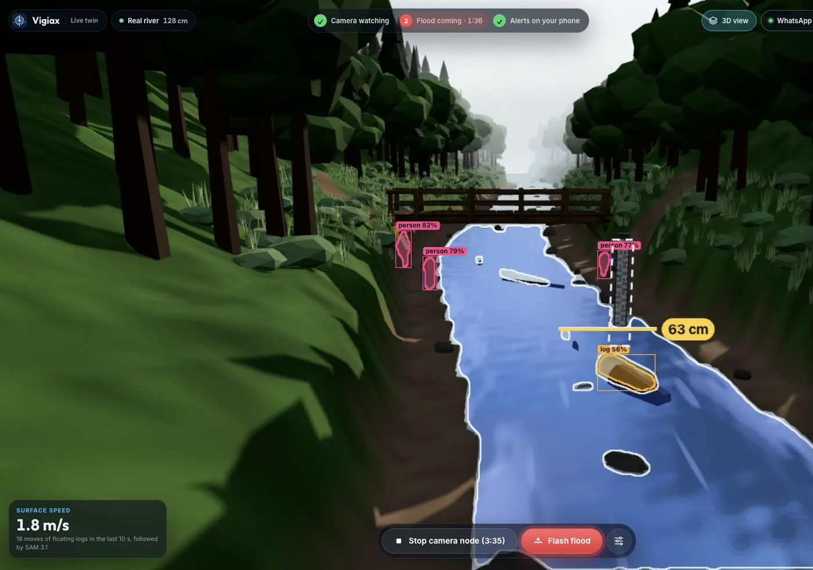
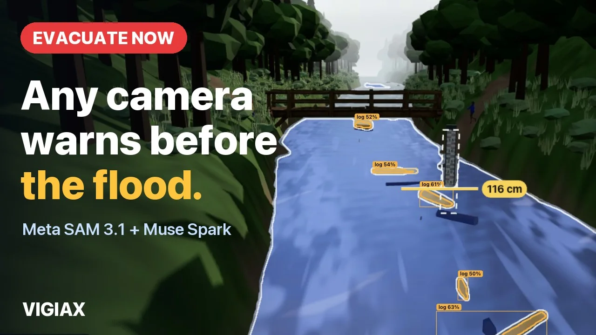
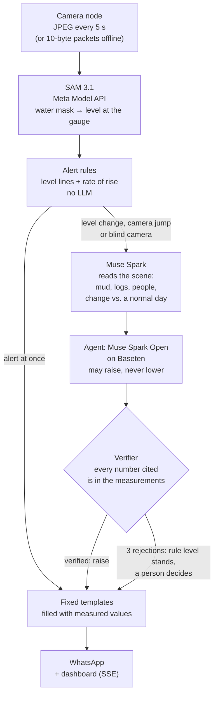
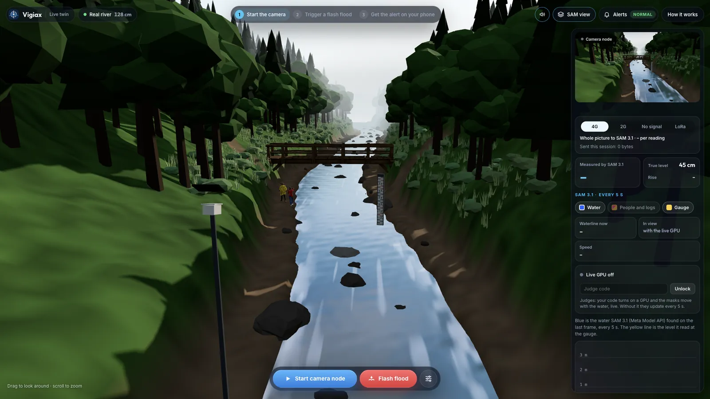
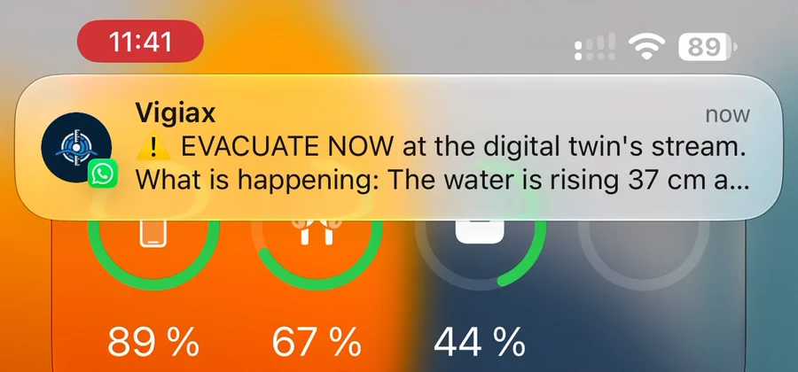
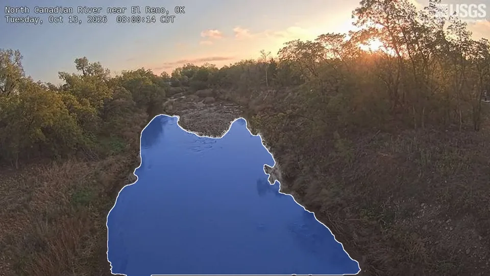
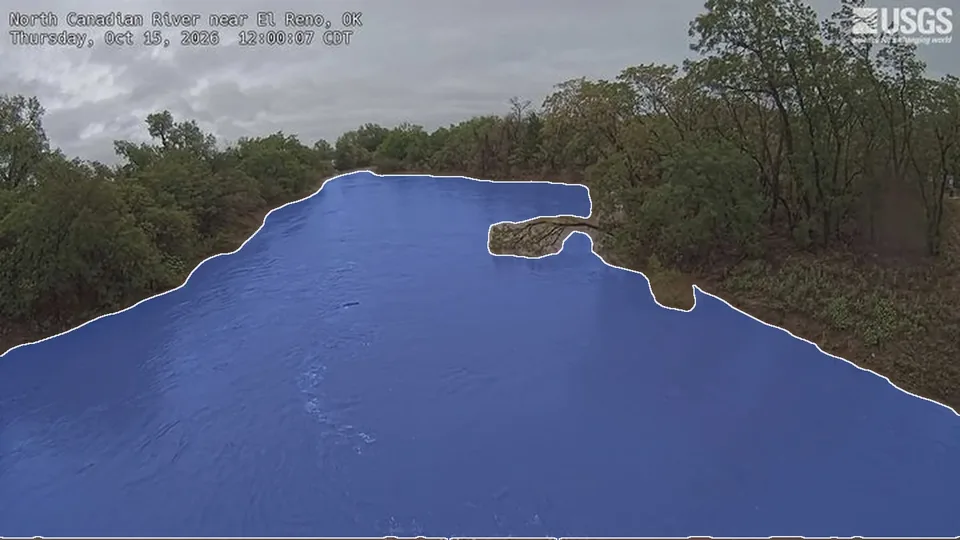

# Vigiax

**Flash-flood early warning from any camera.** SAM 3.1 measures the water, Muse Spark reads the scene, and an agent on
Muse Spark Open warns the people downstream on WhatsApp, in plain words.

**[Live product](https://vigiax.bukivo.com)** · **[Live digital twin](https://vigiax.bukivo.com/twin/)** ·
**[Demo video (3 min)](https://youtu.be/I_Wkjk29lnQ)** · [Evaluation](eval/README.md)

[](LICENSE)




> **Built during the hackathon.** Nothing existed before the Meta Global AI Developer Hackathon: every line of code,
> the digital twin, the evaluation and the live service in this repository were written during the event
> (26 October – 4 November 2026). Open-source dependencies and public data are credited below.

<p align="center">
  <a href="https://youtu.be/I_Wkjk29lnQ">
    
  </a>
  <br><sub>Watch the 3-minute demo on YouTube</sub>
</p>

## The problem

In Colombia, flash floods (*crecientes súbitas*) come down mountain creeks in minutes and kill people every rainy
season. Medellín alone has about 4,200 creeks and fewer than 30 level sensors (SIATA, Medellín's early-warning
system). Where there is no sensor, someone still has to go and look at the water.

A camera is cheap and already common. Vigiax turns one into a river gauge and a warning system: it measures the level
every few seconds, notices what a water level cannot show (mud, logs, people on the bank), and sends a short,
verified alert to the phones of the people downstream.

## How it works



1. **Camera node.** A fixed camera frames the stream and a staff gauge. It posts a JPEG every 5 seconds
   (`POST /api/stations/{id}/frames`). In the twin, the camera is a virtual one inside the 3D valley.
2. **Measurement, always on.** SAM 3.1 on the Meta Model API segments the water. The server finds where the mask
   meets the gauge and turns that row into centimetres with the gauge calibration (Muse Spark reads the printed
   numbers on the gauge; SAM checks where the gauge is). Each frame becomes one reading: level, rate of rise,
   confidence, latency and cost.
3. **Rules, always on.** Fixed rules set the alert level (normal, attention, alert, evacuate) from level lines and
   rise rates, confirmed over several readings. A blind camera never lowers the level. No language model runs here,
   so an alert never waits for one.
4. **Scene reading, on events.** When the rules change level, the camera jumps or goes blind, Muse Spark reads the
   frame: muddy water, debris flow, logs and rocks, people or vehicles near the water, a dammed channel, damaged
   houses. It also compares the frame with the station's normal-day frame. Scene rules can raise the floor on their
   own (a debris flow or a house in the water means evacuate).
5. **The agent, on events.** Muse Spark Open, served on Baseten, gets the facts: the measurements, the last levels,
   the scene, the day's alerts and how many phones are signed up. It may hold the rule level or raise it with a
   reason. It never lowers an alert and never writes what people receive.
6. **The verifier.** Every number the agent cites must match the measurements, and its level must be valid and not
   below the rules. After three rejected answers the rule level stands and a person is asked to decide.
7. **Alerts that cannot lie.** The text people receive comes from fixed templates (Spanish and English) filled
   with measured values: what is happening, what to do, the time. WhatsApp and the dashboard get it at once.

**Cheap loop, LLM on events.** Segmentation runs on every frame; the language models wake only when something
changes. Each agent run logs its tokens, seconds and USD, and the dashboard's agent console shows them per run.
Watching the real river below for 27 days at one photo an hour cost $1.35 in model calls (SAM 3.1 $1.28, agent with
scene reading $0.07; [results](eval/results/alerts-el-reno-2026-10/README.md)).

## Meta models used

| Model | Where it runs | What it does in Vigiax | Called in |
|---|---|---|---|
| **SAM 3.1** (`sam-3.1`) | Meta Model API | Segments the water in every frame; the level is read where the mask meets the gauge | [`server/internal/sam/sam.go`](server/internal/sam/sam.go), [`server/internal/meta/client.go`](server/internal/meta/client.go) |
| **SAM 3.1, open weights** | Rented GPU, on demand | Follows water, people and logs live, a few frames a second, in the live view | [`server/internal/gpu/gpu.go`](server/internal/gpu/gpu.go), [`server/cmd/vigiax/live.go`](server/cmd/vigiax/live.go) |
| **Muse Spark** (`muse-spark-1.3`) | Meta Model API | Reads the scene on events (mud, debris, people, damage, change from a normal day) and reads the gauge numbers for calibration | [`server/internal/scene/scene.go`](server/internal/scene/scene.go), [`server/internal/scene/compare.go`](server/internal/scene/compare.go), [`server/internal/gauge/gauge.go`](server/internal/gauge/gauge.go) |
| **Muse Spark Open** (`meta-models/muse-spark-open-1026`) | Baseten (OpenAI-compatible endpoint) | The alert agent: decides hold or raise from the facts; checked by the verifier | [`server/internal/agent/agent.go`](server/internal/agent/agent.go), [`server/internal/agent/baseten.go`](server/internal/agent/baseten.go) |

SAM 3.1 masks come back as compact "one_bit" payloads; [`server/internal/sam/codec.go`](server/internal/sam/codec.go)
is a Go port of the decoder in Meta's `meta-sam-parser`, under the SAM License.

## The live GPU view

Through the Meta Model API, the mask updates every 5 seconds. With a GPU, the open-weights SAM 3.1 looks at the
twin's camera a few times a second, so the masks move with the water: people on the bank and logs coming down are
boxed and followed, and the surface speed is estimated from the logs' movement.

A judge turns it on from the twin with a judge code; the service rents the GPU, waits until the model is loaded and
links it. It turns itself off a few minutes after nobody is watching. The level is still measured by SAM 3.1 on the
Meta Model API either way; the GPU only draws the live view.

## The digital twin



A stream in a small Andean valley, built in Three.js: pines and mist, foam on the water, walkers on the footpaths and
a wooden footbridge. The camera node stands on a pole and frames the gauge, both banks and the bridge. Anyone can
open it, trigger a flood and get the alert on their own phone.

**Controls:** rain, flash flood (with its length), water level, mud, logs, debris flow, a dammed channel upstream,
people on the bank, day and night (with infrared), raindrops and haze on the lens, camera shake and a knock that
moves the camera.

**Network at the node:** 4G (whole picture), 2G (only the gauge crop, a few kB), no signal, and LoRa. Offline, the
node reads the gauge from its own pixels: while it has signal it learns what the dry gauge looks like (its colours
and printed stripes) from SAM's waterline, and without signal the waterline is where the rows stop looking dry.


<p align="center">
  
</p>

**Alerts on WhatsApp.** People sign themselves up by sending `ALERTAS <station>` (or `ALERTS <station>`) to the
service's number; nobody can sign up someone else's phone. A subscription ends 24 hours after the person's last
message and the number is deleted with it. Each alert has two buttons, *Got it* and *False alarm*.

## Results

Every number below comes from a run in [`eval/`](eval/README.md), with the command to reproduce it in that folder.

| Case | Result | Source |
|---|---|---|
| Twin, flash flood with three people on the bank | The agent raised evacuate **23 s before** the water reached the line, **8 s ahead** of the rules alone | [`eval/results/twin-2026-11`](eval/results/twin-2026-11/README.md) |
| Twin, debris flow | The rules alone **never raised**; the scene reading raised evacuate **61 s before** the flow reached the line | [`eval/results/twin-2026-11`](eval/results/twin-2026-11/README.md) |
| Twin, flash flood alone | Evacuate 22 s before the water reached the line, 7 s ahead of the rules alone | [`eval/results/twin-2026-11`](eval/results/twin-2026-11/README.md) |
| Real river (USGS webcam, El Reno, OK): level | Through a **3.66 m flood**, SAM 3.1 read the level with a **mean error of 6.9 cm** against the official gage (RMSE 12.3 cm, 18 test frames) | [`eval/results/el-reno-2026-10`](eval/results/el-reno-2026-10/README.md) |
| Real river: false alarms | **0 false alarms in 21 calm days** (315 frames), rules alone and rules + agent | [`eval/results/alerts-el-reno-2026-10`](eval/results/alerts-el-reno-2026-10/README.md) |
| Real river: the flood | The agent raised *alert* **an hour before the rules** (2 h before the gage crossed the line) | [`eval/results/alerts-el-reno-2026-10`](eval/results/alerts-el-reno-2026-10/README.md) |
| Real river: cost | 27 days, one photo an hour: SAM 3.1 $1.28 + agent $0.07 | [`eval/results/alerts-el-reno-2026-10`](eval/results/alerts-el-reno-2026-10/README.md) |

<table>
  <tr>
    <td></td>
    <td></td>
  </tr>
  <tr>
    <td align="center"><sub>El Reno before the flood, SAM 3.1 mask</sub></td>
    <td align="center"><sub>At the peak, SAM 3.1 mask</sub></td>
  </tr>
</table>
<p align="center"><sub>Imagery: U.S. Geological Survey (public domain).</sub></p>

**How to read them.** The twin results are one run per case: the language models can answer differently on another
run, and SAM's reading of thick mud varies. The twin is a simulation; the models are real, called by the service as
in production, and the twin sends its true level with each frame so every alert is timed against the truth. El Reno
is one real flood seen at one photo an hour, so its times are good to about an hour, and the agent's earlier alert
is one case, not a rate. The El Reno level fit and test frames come from the same event (alternate frames).

Scene reading on real and AI-generated photos is in [`eval/results/scene-2026-10`](eval/results/scene-2026-10/README.md)
and [`eval/results/scene-ai-2026-10`](eval/results/scene-ai-2026-10/README.md).

## Built for low connectivity

Mountain villages lose signal first, so the node is built to need less:

- **It sends numbers, not video.** On 2G it sends only the gauge crop; with no signal or over LoRa it sends a
  10-byte packet per reading (time, level in mm, confidence, siren flag, sequence; `POST /api/stations/{id}/node`).
- **Local siren.** Offline, the node measures by itself and sounds its siren at the evacuate line.
- **Store-and-forward.** Readings are kept as packets and sent when the link comes back; the service files them
  with their original times.
- **LoRa.** The same packets, one every 30 seconds, within a LoRa node's duty cycle.

Not built yet: an upstream node relaying its warning to the village downstream, and SMS as a fallback.

## Run it locally

You need Go 1.25+, Node 20.19+ or 22.12+, a Meta Model API key and, for the agent, a Baseten key.

```sh
cp .env.example .env          # fill in MODEL_API_KEY and BASETEN_API_KEY

# service on :8790 (readings are stored in server/var/)
cd server
set -a; . ../.env; set +a
go run ./cmd/vigiax

# web, in another terminal: landing on http://localhost:5173, twin on http://localhost:5173/twin/
cd web
npm install
npm run dev
```

Without `BASETEN_API_KEY` the agent is off and the rules alone raise alerts. WhatsApp alerts need a WhatsApp
Business Cloud API number (`WA_*` variables in [`server/cmd/vigiax/main.go`](server/cmd/vigiax/main.go)); without
them, alerts show on the dashboard only. Tests: `cd server && go test ./...`.

Useful tools in `server/cmd/`: `probe` (run SAM 3.1 and Muse Spark on still images, with latency and cost),
`overlay` (paint SAM masks for several prompts), and the evaluations `evaltwin`, `evalusgs`, `evalalerts` and
`evalscene`.

## Repository layout

```
server/                 Go service (standard library only)
  cmd/vigiax/           the station service: frame ingest, alerts, agent runs, WhatsApp, live view, SSE
  cmd/eval*/            evaluations: twin lead time, USGS level, alerts on real frames, scene reading
  cmd/probe, overlay/   model probes on still images
  internal/sam/         SAM 3.1 on the Meta Model API, mask decoding
  internal/meta/        Meta Model API client and pricing
  internal/scene/       Muse Spark scene reading and normal-day comparison
  internal/agent/       the agent (Muse Spark Open on Baseten) and its verifier
  internal/alert/       alert rules and the fixed message templates
  internal/gauge/       gauge calibration, pixel row → centimetres
  internal/station/     a camera's configuration, calibration and level series
  internal/gpu/         client for open-weights SAM 3.1 on a rented GPU
  internal/usgs/        USGS webcams and gage heights
  internal/whatsapp/    WhatsApp Business Cloud API
  whatsapp-templates/   message templates (Spanish and English)
web/                    Vite + TypeScript
  index.html            landing page
  twin/index.html       the digital twin (Three.js)
  src/                  twin world, camera node, network modes, SAM view, alerts, agent console
  public/               3D models, sounds, images
eval/                   evaluation cases and results (README per run, with the command)
data/manifest.json      source, licence and author of every clip and photo used
docs/                   demo video script, README images
```

## Data, assets and licences

- **Code:** [MIT](LICENSE). `server/internal/sam/codec.go` ports Meta's `meta-sam-parser` decoder, under the
  [SAM License](server/internal/sam/LICENSE-SAM).
- **USGS imagery and gage data:** North Canadian River near El Reno, OK (webcam and gage 07239500).
  Imagery and data: U.S. Geological Survey (public domain).
- **3D models and sounds in the twin:** people and the footbridge generated with Meshy, stream sounds generated with
  ElevenLabs, all for Vigiax during the event; details and terms in [`ASSETS.md`](ASSETS.md). Everything else the
  twin draws (terrain, water, trees, rocks, debris, gauge, mist) is made in code.
- **AI-generated creek clip:** generated with Leonardo.ai from our own prompt, used only for scene-reading tests
  (labeled synthetic) and as a labeled context shot in the video. Source and terms in
  [`data/manifest.json`](data/manifest.json).
- **Photos for the scene evaluation:** Wikimedia Commons, public domain and CC licences, each listed with author and
  licence in [`data/manifest.json`](data/manifest.json). Raw files are not in the repository.
